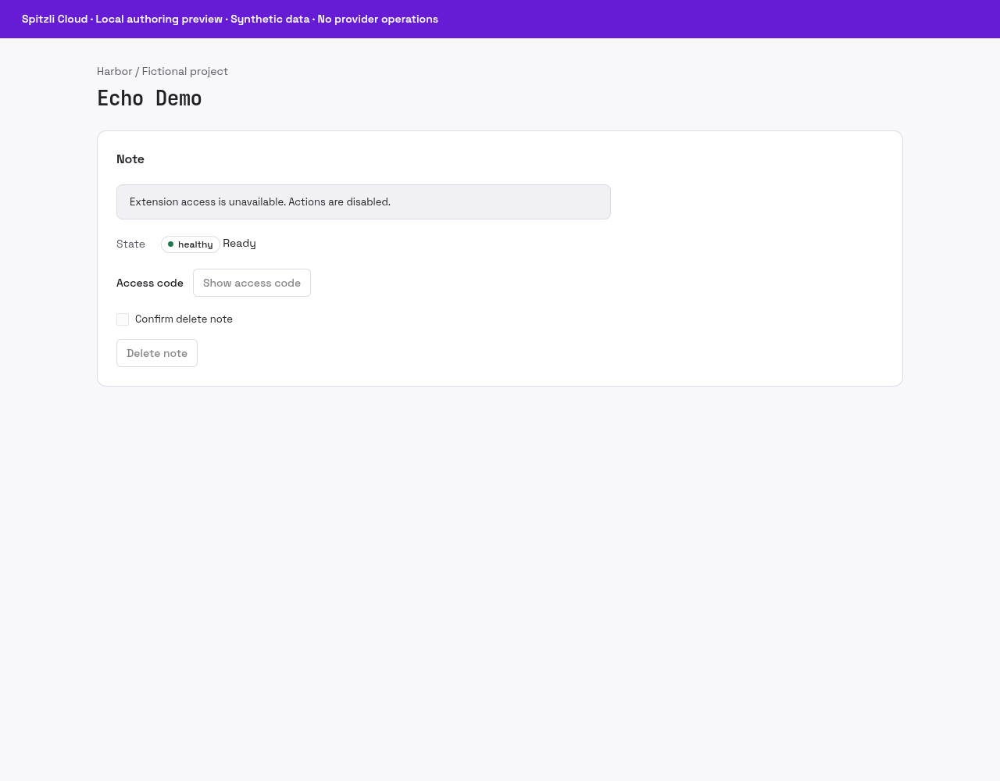

# Echo Demo


Explore a minimal native plugin contract before developing an integration.

## What you can do

A scoped echo operation and a small declarative note panel demonstrate project authority, secret reveal and explicit deletion.

## Setup and access

An operator installs this demonstration release and enables its demo actions for a test project. No external provider or customer credentials are required.

## Data and security

The host supplies signed project scope. Note identifiers and access-code responses are demonstration values. Do not use this plugin as durable note storage.

## Status and limits

Developer beta and protocol example. The echo input is limited to 200 characters. This is not the full Project Notes product or a production data store.

Catalog publication does not activate the plugin, enable public signup or grant
access to any customer resource. A new presentation release must use a new version;
previously signed releases and their assets stay immutable.

## Gallery

Actual Console declarative renderer using the demo note response; synthetic data and disabled actions.



## Catalog source

`.tabularium` is the complete catalog-refresh source. It retains the immutable
runtime image and full protocol/access contract of the currently released
`0.1.0` and adds the prepared presentation assets. Refresh it only from a
reviewed immutable source commit. This does not replace signed release assets
or activate the runtime.

## Technical reference

The retained implementation notes below include platform integration procedures.
Commands referring to Core, `tools/` or `apps/console` require the [platform source
checkout](https://github.com/spitzli/webdock); they are not standalone setup steps.

Minimal reference plugin for the generic Webdock plugin runtime: no capabilities, host services or external providers. It exposes the scoped `demo.echo` action, the `demo.operator` panel and a declarative note resource example within the signed project. The runtime refuses any manifest except the reviewed `manifest.json` contract (apart from the pinned image digest).

The root `Tiltfile` builds its image (`Dockerfile`, from the repository root), pushes it to the local registry and seeds it as an installed release. The local process uses private Unix sockets for its listener and the Core callback; use the generic chart and mutual TLS for remote runtimes.

```sh
cargo test --manifest-path Cargo.toml --locked
cargo clippy --manifest-path Cargo.toml --locked --all-targets -- -D warnings
```
